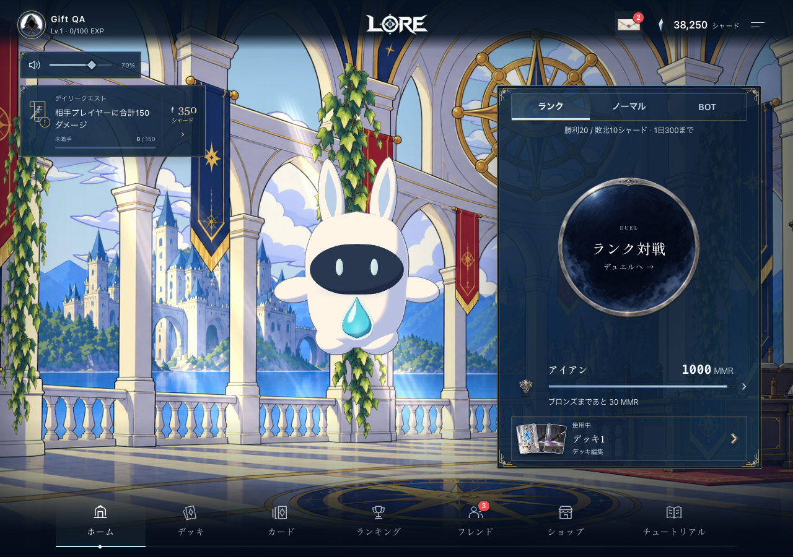
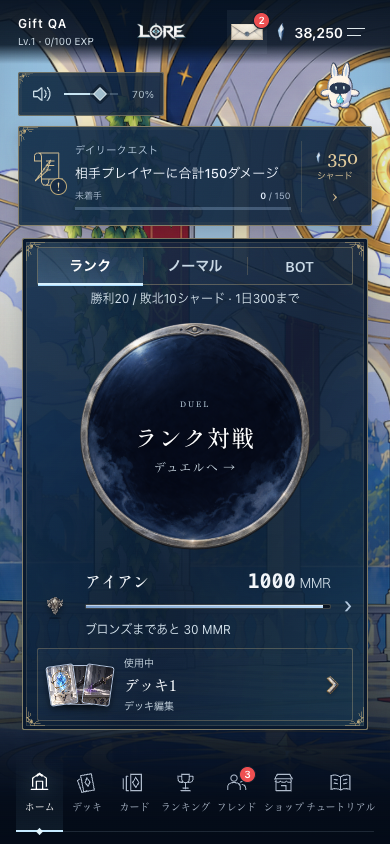

# 2026-10-26 通知件数バッジ

承認済みプレビューの赤い件数バッジを、既存プレゼントの封筒と下ナビのフレンドアイコン右上へ実装。プレゼントの画面・受取操作・メニュー構成は維持。

## 件数と更新

- プレゼント: 未読・未受取・期限内の件数。サーバー集計に `unreadCount` を追加し、一覧300件の上限に左右されない。従来の未受取件数・金額も維持。既存の一覧選択で既読を記録し、サーバー確認後に件数更新。受取後も再取得する。
- フレンド: 受信したフレンド申請と対戦招待。送信済み申請は対象外。フレンド画面は既存5秒ポーリングの結果を共有、その他メニューは8秒ごと・フォーカス復帰時に更新。非表示タブとゲストは取得しない。
- 0件は非表示、100件以上は `99+`。読み上げには省略前の件数を使用。通信失敗では最後に確認した件数を保持。画面破棄時に取得・タイマーを停止し、古いレスポンスや別アカウントの件数を反映しない。
- D1スキーマ・マイグレーションの変更なし。

## 検証

- client/server typecheck。
- `tests/gift-inbox.mjs`: 10シナリオ群。既読・受取済み・期限切れの除外、305件の未読集計、既存の受取・冪等性・アカウント分離を検証。
- `tests/notification-badges.mjs`: 申請＋招待、0/99+、ヘッダー再描画、通信失敗、古いレスポンス、アカウント変更、ゲスト、破棄、既存フレンドポーリングとの共有を検証。
- `tests/gift-inbox-browser.mjs`: 実装の画面にAPIフィクスチャを使用。1280×900 / 1280×720 / 390×844 / 320×568 / 844×390、既存ダイアログ、個別・一括受取、既読による減算、履歴、再読み込み、エラーからの復帰、フレンド承認・拒否による減算、3言語、Escapeとフォーカス復帰を確認。ブラウザー例外0件。
- スクリーンショットで封筒とフレンドアイコン右上のバッジ、PC・スマートフォンの可読性を確認。

ローカル結果: [qa/local/result.json](qa/local/result.json)。認証済み実アカウント同士での新規申請送信は検証対象外。ブラウザー検証中に実ユーザーの申請・プレゼントは変更していない。

## リリース

Source: `7d48c2e31b2c5de058faa0d9f4eaec6fddcc0d0d`。

- `scripts/deploy-guard.mjs production` 成功。公開日時: 2026-10-26 15:27 JST。
- Typecheck / 全体テスト **213/213** / design guard / Viteビルド成功。
- Worker: `204ee291-c316-4801-8dc1-989b3de0778e`、配信比率100%。Deployment: `3a3ec773-622e-4adc-8971-0ec7156ac0fa`。
- https://yourlore.xyz のHTML・JS・CSS・JSONと背景3レイヤー **153/153** が隔離ビルドのSHA-256と一致。
- 公開先の実配信アセット＋APIフィクスチャでブラウザー回帰を再実行し成功。PC・スマートフォンのスクリーンショットも確認。実アカウントの申請送信・プレゼント配布は実施していない。
- [全体テスト](suite.json) / [配信照合](asset-parity.json) / [本番バージョン](deployment.json) / [公開先ブラウザー結果](qa/production/result.json)

