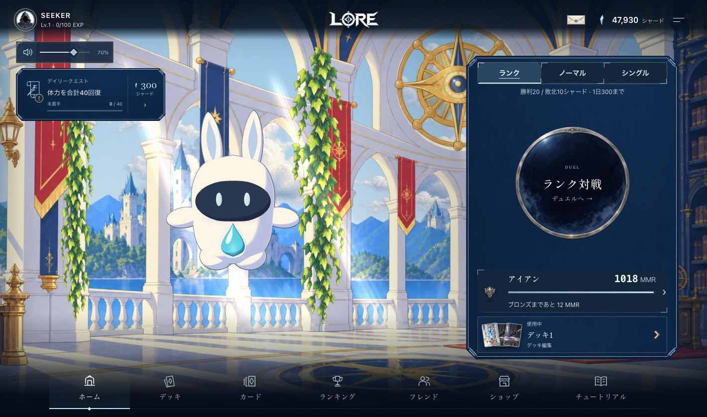
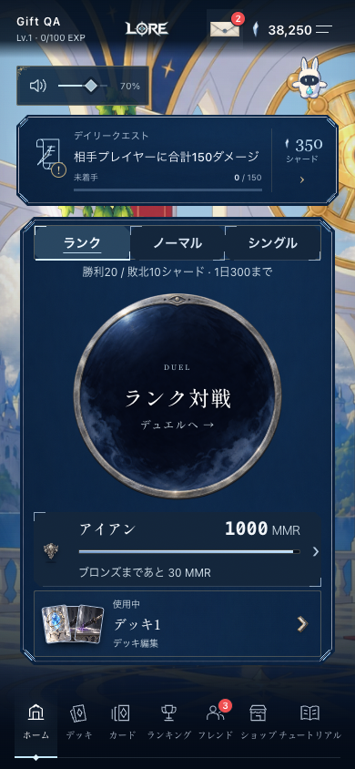

# 背景の細い輪郭と自然な雲

ユーザー指定: Zenoに対して背景の線が濃すぎるため薄くし、雲をもう少しリアルにする。完成後、本番公開まで実施。

建築・旗・金属装飾の黒い輪郭を淡い局所色の細い線へ変更。構図・城・柱・床の配置と色面を保ち、ツタの葉脈・輪郭も軽くした。雲はインク輪郭をなくし、白い光、青灰色の陰影、薄い蒸気状の縁を持つ素材に交換。元の0.65倍の雲サイズと移動・ツタのメッシュ変形・城の後ろの鳥を維持。輪郭を再び濃くする既存のシャープ化シェーダーは除去。

## 参照と起動元

- 作業開始時 `443c14d8`、tracked差分なし。リモートmainへfast-forwardした `c1b4a6d2` を土台として実装。主チェックアウトの未コミット作業は変更していない。
- 参照: `client/src/ui/homeAtmosphere.ts`（背景採用コミット `7c47e8ef`）、`client/src/ui/zenoToonSurface.ts`、`client/src/ui/manaSpirit.ts`、`client/src/styles/defaultUI.css`、`client/src/styles/defaultButtons.css`。最新の面取りUIと隅のしるしボタンを使用。
- 開始時に確認した本番sourceは `b2373586558e515ec238ee0a88a0ec5bbfd52569`。参照mainまでの背景・Zeno・HOME実装に差分なし。共通ボタンの例外指定更新はmain側を維持。
- Vite起動元: `/Users/hiromaru05s/.codex/worktrees/zeno-material-three/LORE_TCG/client`。
- ローカルプレビュー: http://127.0.0.1:5549/soft-background-preview.html 。`client/src/dev/defaultUIFixture.ts`から現行App・HOME・共通CSSを直接使用。旧背景比較ページは起点にしていない。HTMLはローカル限定で本番ビルド対象外。
- ブラウザーで `data-atmosphere=ready`、CSS背景の `toon-soft-20261026/library-wide.webp` と `clouds.webp` を確認。スクリーンショットと起動元cwdも照合。

## 素材

組み込み image_gen で3素材を作成、alphaを保ったままWebP形式へ変換。CLI画像生成・色調フィルターでの置換は使用していない。

保存先: `client/public/art/lounge/toon-soft-20261026/{library-wide,clouds,ivy}.webp`。旧素材は履歴・比較用に保持。HTMLプリロード・共通CSS・静的フォールバック・WebGL・メニューキャッシュリストを同じrevisionに更新。

生成指示は [prompts.md](prompts.md)。元の生成PNGはCodex生成フォルダに保存、製品が参照する最終素材は上記リポジトリ内へ格納。

## 検証

- TypeScript client/server成功。
- `tests/home-atmosphere-browser.mjs`: 4サイズ、連続描画、共有日照変化、低減モーション、非表示タブ停止、HOME再入場、WebGL喪失・非対応、読み込み中の破棄、低減モーションでの遅延日照反映が成功。例外0件。
- 自然な雲の透過領域では日照が一時的に最大値で安定するため、テストは1.2秒固定の2点比較から、日照周期内の変化と進む時計を確認する上限25秒の観察へ更新。
- `tests/home-distant-birds.mjs` と `tests/zeno-toon.mjs` 成功。鳥の間欠飛行・羽ばたき・方向・城の後ろへの描画順と、Zenoのトゥーン構造を確認。
- `tests/zeno-home-browser.mjs` は現在のgift API形式にフィクスチャを修正し、`ZENO_BASELINE=1`の表示確認を実施。完全なZeno操作回帰は、新しい共通ボタンCSSのキーボードoutlineと旧「outline none」期待値が一致しないため完走していない。この変更ではZeno/CSSフォーカスは変更していない。
- 機能検証とは別に、PC・スマートフォン・横画面で線の軽さ、雲の自然な陰影、最新共通UIとZenoの維持を目視確認。APIはフィクスチャ、実アカウント・物理端末での検証ではない。

## 公開結果

背景変更コミット `63e0fdd6e9c2246e9f18fb2a8c3dfdae2b6d7921` を含む `394e7b6e75058a5b3e5b1e3e4c8a57bc1e14bfe2` が共有のguarded releaseで公開済み。2026-10-26 18:59（Asia/Seoul）。最初の単独デプロイは他リリースのロックで停止したため、同じ変更を含む共有リリースの完了を追跡した。

- client/server typecheck、全体テスト **228/228**、design guard、production build成功。[検証ログ](validation.log)。
- 有効Worker版 `e6b70717-470b-4a9f-8231-d1a5223b32ea`、100%。Deployment `638a951c-0d22-4253-882a-4b550575cdd9`。[配信状態](deployment.json)。
- 隔離されたguardビルドからハッシュを採取し、https://yourlore.xyz のHTML/JS/CSS/JSONと新背景3素材 **152/152** のSHA-256一致を確認。[配信照合](asset-parity.json)。
- 公開先の実アセット＋APIフィクスチャでHOME表示、5サイズ、プレゼント・フレンド操作、3言語の回帰が成功。ブラウザー例外0件。PCとスマホの画像を目視確認。実アカウントでの操作は実施していない。

