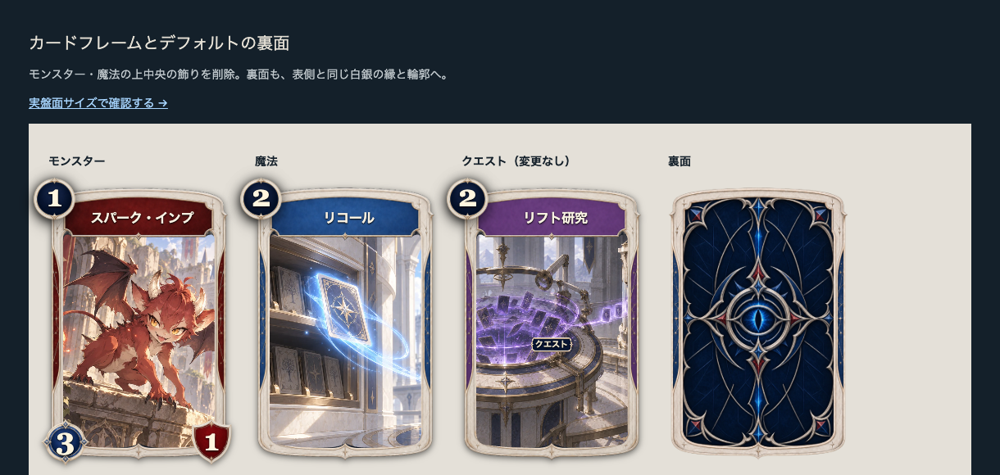

# Simple card frames and the matching default reverse

Local implementation, 2026-11-20. Not deployed.

## Source verification

- Working baseline: `249928094`, branch `codex/seven-spell-nameplate-1119`.
- Fetched `gh/main`: `b70066ac3`. No incoming changes to the adopted modular frame art, default sleeve, shared card/cosmetic catalogs, pile stock or PaperCard source. Incoming cardView changes add Attune rules text; they do not replace frame art.
- Preserved this chat's approved real board, portrait, mana/nameplate/insignia furniture, seven-slot icon row, and opponent monster spacing.
- Serving directory: `/Users/hiromaru05s/.codex/worktrees/nameplate-board-1119/LORE_TCG/client`.
- Actual board: http://127.0.0.1:5473/identity-furniture-preview.html
- Actual card components and inventory picker: http://127.0.0.1:5473/card-frame-preview.html

## Assets and rendering

Built-in imagegen edits remove only the top-center compass medallion from the monster/spell full and compact frames. Quest art is unchanged. The default reverse retains the blue eye motif inside an ivory/silver border following the face silhouette. The generated alpha is preserved (RGB outside the cutout is irrelevant).

Saved masters: `client/public/art/biblion/modular/{base,field}-{mon,spell}.png` and `client/public/frames/sleeve_default.png`. Corresponding print, lossless, UI and deck display derivatives are refreshed. The existing black-matte transfer remains the production compositing policy for face frames; UI derivatives remain 512px lossless.

- `cardSurface.ts`: no rounded rectangular crop on the reverse.
- `pileModels.ts`, `cardStockShape.ts`, `paperCard.ts`: a shared physical perimeter traced from the default reverse alpha; face/back UVs cover the full authored canvas.
- `scripts/build-card-stock-outline.mjs`: reproduces geometry from the stored master; does not alter artwork.
- Opponent hand and native draw reverse: no legacy inset clip, rounded crop or rectangular inset border. Existing draw trajectory/timing is preserved.

## Availability

- Only default is offered by `SLEEVE_LIST`; previously equipped IDs resolve to default on both client and server deck normalization.
- All owned cosmetic IDs remain in the catalog and inventory. No database migration/deletion.
- Profile equipment and purchase routes reject non-default sleeves before a mutation.
- Disabled sleeves are excluded from the active gacha pool and visible lineup. Category chances stay 92.5% starter / 7% furniture / 0.5% effect; available furniture share the cosmetic category equally. The display uses this same active pool.
- Japanese, English and Korean picker/lineup copy updated.

## Verification

- Client and server TypeScript checks.
- `tests/gacha-cosmetics.mjs`: inventory retention, all disabled equipment IDs, legacy deck fallback, furniture unaffected, active pool.
- `tests/default-sleeve-api.mjs`: equip and purchase rejection with a DB stub that throws on any access.
- Real fixture board at 1920×1080 and 1280×720: actual modular print assets/default reverse loaded; opponent hand has no old inset clip; zero page errors.
- Actual deck picker with every historical sleeve marked owned: exactly one selectable sleeve, default.
- `tests/draw-back-color-browser.mjs` passes at 1280px and 390px: own/opponent sleeve rendering, opponent identity privacy, cancellation, normal-speed completion and cleanup. Results: `draw-checks.json`.
- Existing draw regression fixture updated for the adopted native-card renderer: retained face children are source content, and opponent draws now use the shared native presentation instead of the historical Web Animation ID. This fixture uses its own legacy board furniture; the preview URLs above are the reference for current board appearance.
- No authenticated multiplayer or production verification. These are local fixture checks; visual approval remains with the user.

Built-in imagegen asset provenance and prompt records: [imagegen.json](imagegen.json).

2026-11-20 follow-up: user authorized production release. The production adoption and release evidence are tracked in `docs/releases/2026-11-20-identity-board/`.
